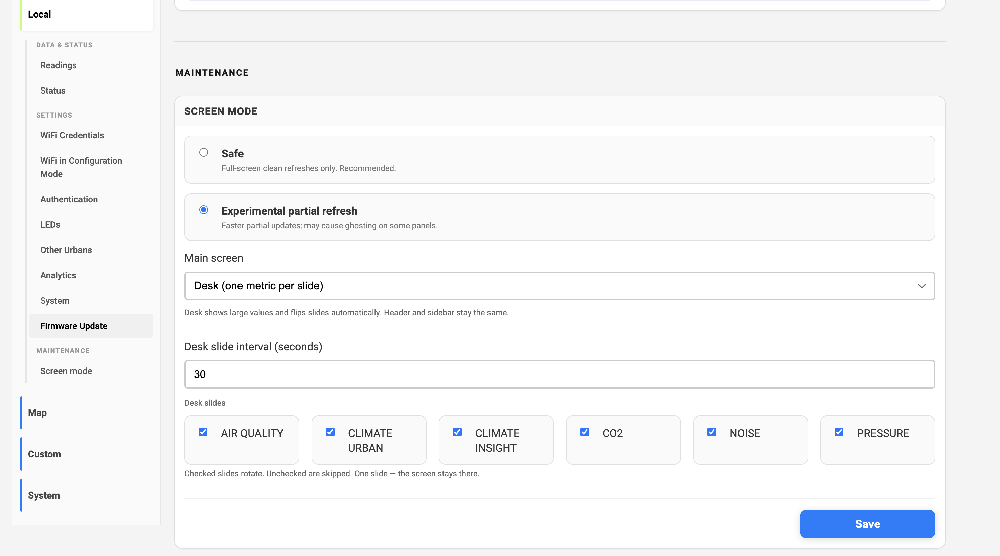
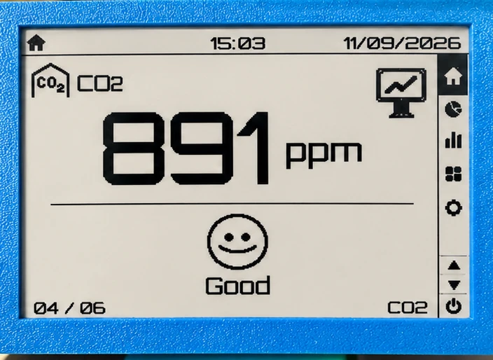
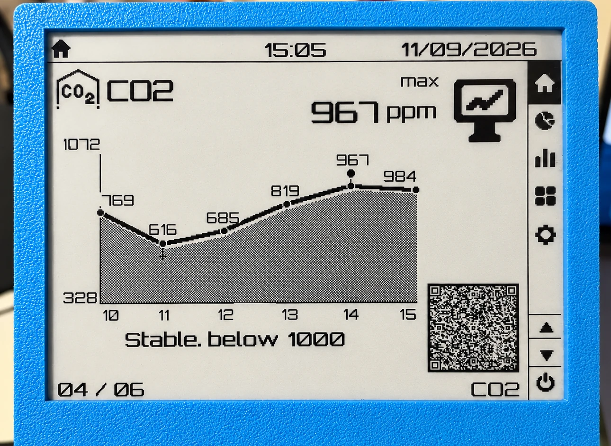
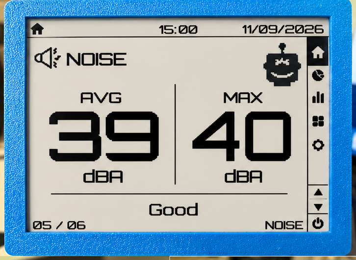
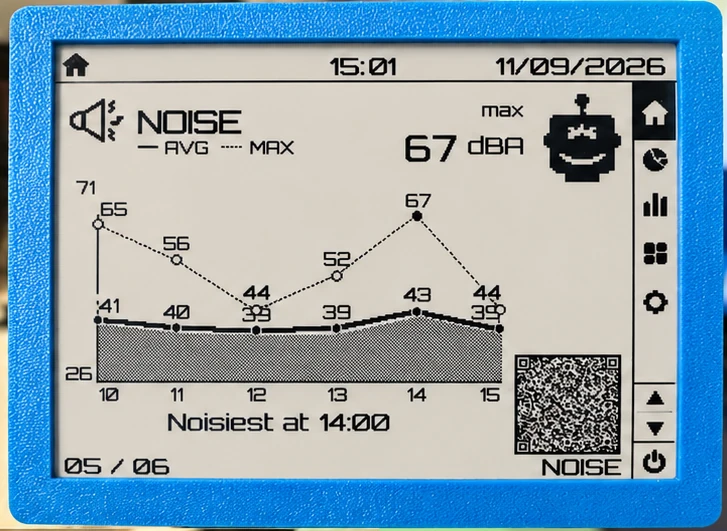
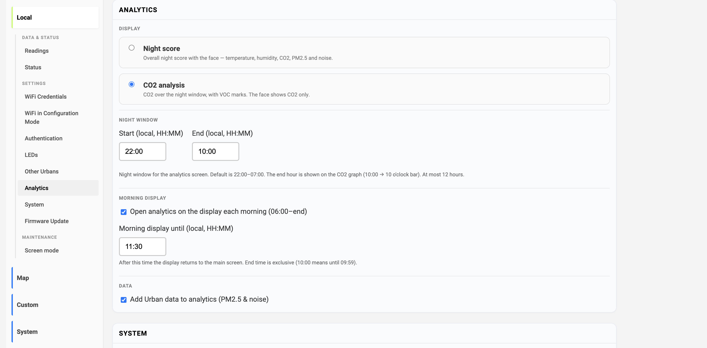
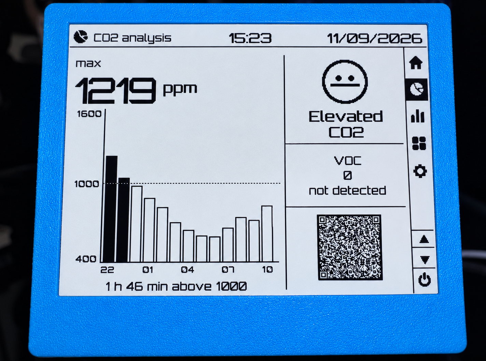

The default Insight main screen still shows everything at once. That is useful at a glance, and hard to read from across the room.

Insight now has **Desk** — one metric, large, then a graph of the last six hours — and a choice of what the Analytics screen should be: the night comfort score, or a CO2-centered night review.

---

## Desk mode

**Local → Screen mode**, switch **Main screen** to **Desk**. Header and sidebar stay the same. The body becomes a carousel.

Each metric has two beats:

1. A large current value (and a short status word: Good / Elevated / High / Low)
2. A full-width graph of the **last 6 hours**

Then the next metric. Numbers stay for **60 seconds** by default; the graph stays **30 seconds**. The numbers interval is in the same settings (30–300 s).

### Which slides

Checkboxes under **Desk slides**. Unchecked slides are skipped. One slide — the screen stays there (CO2 only, for example).

| Slide               | What you see                              |
| ------------------- | ----------------------------------------- |
| **Air**             | PM2.5 and PM10, then a graph for each     |
| **Climate Urban**   | Outdoor temperature and humidity          |
| **Climate Insight** | Indoor temperature and humidity           |
| **CO2**             | Indoor CO2                                |
| **Noise**           | Average and max, then one graph with both |
| **Pressure**        | Urban and Insight, if both are there      |

Standalone Insight hides the Urban-only slides (air, noise, outdoor climate).

The graph is an hourly line, not a wait-for-six-hours screen: empty hours stay on the axis, the line connects across gaps. A peak mark sits on the true high. After a reboot the current hour can look empty until the sensor publishes again — older hours stay.

A QR on the graph opens that metric on [sensors.social](https://sensors.social).

---

## Analytics: night score or CO2

The settings block is now **Analytics** (it used to be Sleep analytics). Two screens, same night window:

| Option           | What the e-paper shows                                           |
| ---------------- | ---------------------------------------------------------------- |
| **Night score**  | A circle score — temperature, humidity, CO2, PM2.5 and noise     |
| **CO2 analysis** | Night CO2 as hourly bars, VOC spikes, a CO2-only face, then a QR |

**CO2 analysis is the default**, so a device you already use does not jump to a different analytics layout after the update. Switch to Night score if you want the circle score.

How the CO2 screen reads:

- Each bar is that hour’s **max** CO2
- The bar fills when the peak is **≥ 1000 ppm**
- Minutes above 1000 come from how much of the hour was over that line (≥ 90% of the samples counts as the whole hour)
- Face: **Good** / **Elevated** / **High** for CO2 only (High if max ≥ 2000 ppm, Elevated if at least 30 minutes over 1000)
- VOC is a spike count for this night window

The older Night score model is unchanged in spirit; the full write-up is [Insight Sleep Analytics](/blog/insight-sleeping-analytics). One update: a noise peak hour is now **> 40 dBA** (it was 45).

### Night window

Default is **22:00–07:00** local. Set any start and end in Analytics settings. The window is at most **12 hours** — a longer range is clipped from the start so the bars still fit. The end hour is drawn (22:00–10:00 shows a 10 o’clock bar).

---

## If something looks off

If a slide is blank, a graph caption looks wrong, or the night window does not match what you set, open an issue at [github.com/airalab/altruist-firmware](https://github.com/airalab/altruist-firmware) and include the version from **Status → Technical details**.
