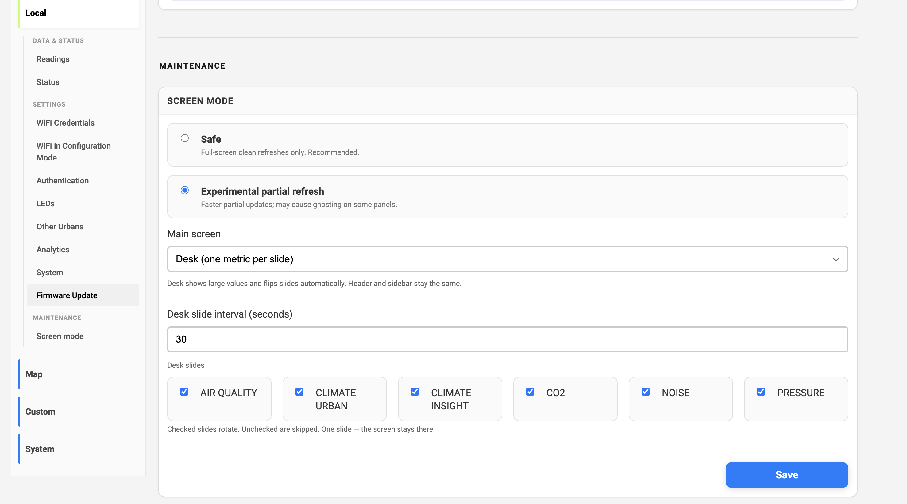
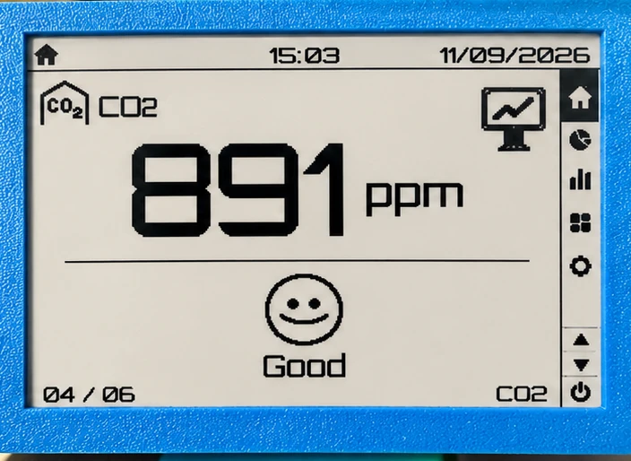
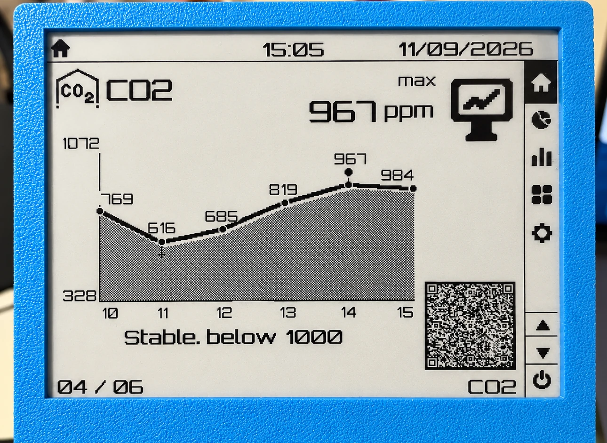
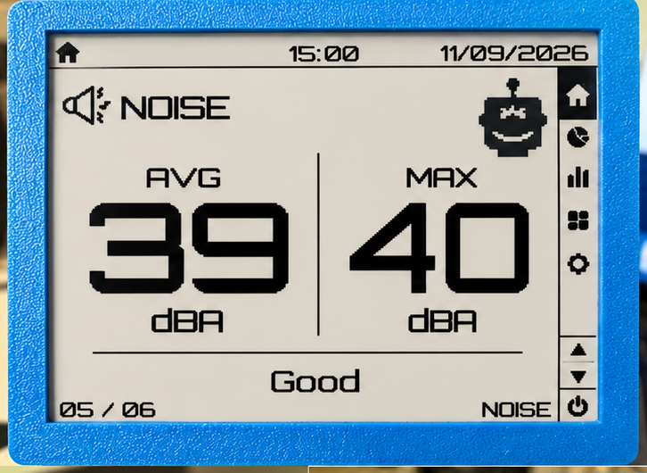
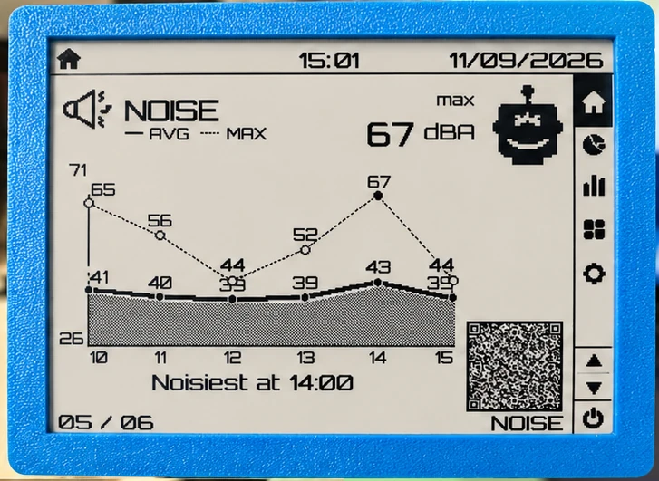
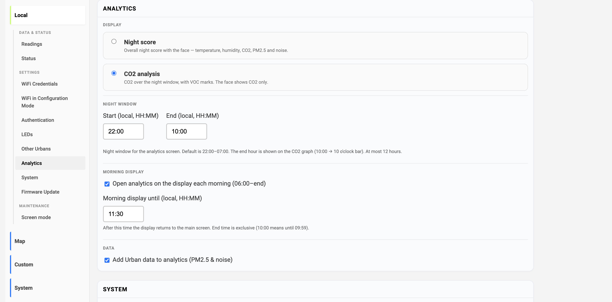
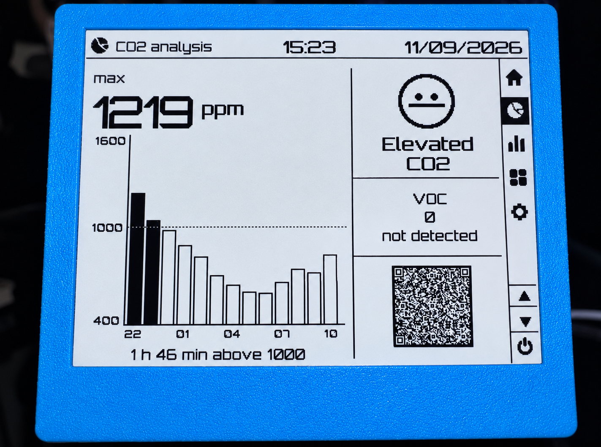

Обычный главный экран Insight по-прежнему показывает всё сразу. С близкого расстояния удобно, из другого конца комнаты — уже нет.

Теперь в Insight есть **Desk**: один крупный показатель, затем график за последние шесть часов. И выбор, что показывать в аналитике: ночной комфорт-скор или разбор ночи вокруг CO2.

---

## Desk mode

**Local → Screen mode**, в **Main screen** выберите **Desk**. Шапка и боковая панель те же. Меняется только середина.

У каждого показателя два такта:

1. Крупное текущее значение (и короткое слово статуса: Норма / Повышен / Высокий / Низкий)
2. График на всю ширину за **последние 6 часов**

Потом следующий показатель. Цифры висят **60 секунд** по умолчанию, график — **30 секунд**. Интервал для цифр задаётся в тех же настройках (30–300 с).

### Какие слайды

Галочки **Слайды Desk**. Снятые пропускаются. Если включён один — экран на нём и остаётся (например, только CO2).

| Слайд               | Что на экране                                  |
| ------------------- | ---------------------------------------------- |
| **Air**             | PM2.5 и PM10, затем график каждого             |
| **Climate Urban**   | Уличная температура и влажность                |
| **Climate Insight** | Комнатная температура и влажность              |
| **CO2**             | CO2 в помещении                                |
| **Noise**           | Среднее и максимум, затем один график с обоими |
| **Pressure**        | Urban и Insight, если есть оба                 |

Standalone Insight прячет слайды, которым нужен Urban (воздух, шум, уличный климат).

График — это линия по часам, а не ожидание полных шести часов: пустые часы остаются на оси, линия соединяется через пропуски. Метка пика стоит на настоящем максимуме. После перезагрузки текущий час может быть пустым, пока сенсор снова не отдаст чтение — старые часы остаются.

QR на графике открывает эту метрику на [sensors.social](https://sensors.social).

---

## Аналитика: ночной скор или CO2

Блок настроек теперь называется **Аналитика** (раньше Sleep analytics). Два экрана, одно и то же ночное окно:

| Опция            | Что на e-paper                                                  |
| ---------------- | --------------------------------------------------------------- |
| **Night score**  | Скор в круге — температура, влажность, CO2, PM2.5 и шум         |
| **CO2 analysis** | Ночной CO2 столбиками, спайки VOC, лицо только по CO2, затем QR |

**По умолчанию стоит CO2 analysis**, чтобы уже используемое устройство не сменило картинку аналитики само после обновления. Night score — если нужен скор в круге.

Как читать экран CO2:

- Столбик — **максимум** CO2 за этот час
- Заливка, если пик **≥ 1000 ppm**
- Минуты выше 1000 — по доле замеров за час (≥ 90% считается за весь час)
- Лицо: **Норма** / **Повышен** / **Высокий** только по CO2 (Высокий, если макс ≥ 2000 ppm; Повышен, если не меньше 30 минут выше 1000)
- VOC — это счётчик спайков за это ночное окно

Ночной скор по смыслу тот же; подробно — в [Insight Sleep Analytics](/ru/blog/insight-sleeping-analytics/). Одно изменение: час шума считается пиком, если **> 40 дБА** (было 45).

### Ночное окно

По умолчанию **22:00–07:00** по локальному времени. Старт и конец задаются в настройках аналитики. Окно не длиннее **12 часов** — более длинный диапазон обрезается с начала, чтобы столбики поместились. Час конца рисуется (22:00–10:00 даёт столбик на 10).

---

## Если что-то не так

Если слайд пустой, подпись графика странная или ночное окно не совпадает с настройкой, откройте issue: [github.com/airalab/altruist-firmware](https://github.com/airalab/altruist-firmware), в тексте — версия из **Status → Technical details**.
