Мы искали другой датчик качества воздуха, у которого открыто всё вокруг: железо, прошивка, сервер, который принимает данные, карта, которая их показывает, и сами данные — подписанные на устройстве и записанные в публичный блокчейн. Не нашли.

Поэтому вот Altruist, слой за слоем, со ссылкой на каждый. Всё ниже лежит на GitHub под открытыми лицензиями, и проверить это может любой.

## Железо: платы до последнего слоя

В [репозитории железа](https://github.com/airalab/hardware/tree/main/Altruist) лежат оба модуля: Altruist Urban для улицы и Altruist Insight для комнаты. Для каждой платы — схема, все медные слои разводки, Gerber-файлы для фабрики, файл расстановки компонентов, спецификация и 3D-модель платы. Исходные проекты EasyEDA Pro, которые можно редактировать, тоже там: [Urban](https://github.com/airalab/hardware/tree/main/Altruist/Urban/Project) и [Insight](https://github.com/airalab/hardware/tree/main/Altruist/Insight/Project).

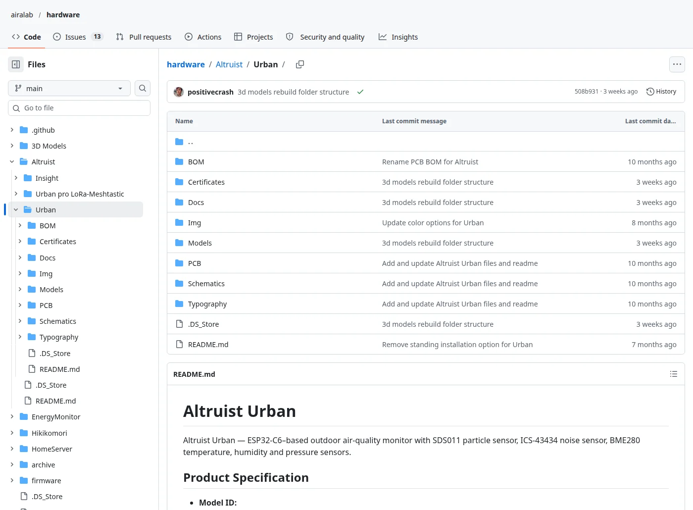

*Altruist Urban в [airalab/hardware](https://github.com/airalab/hardware/tree/main/Altruist/Urban).*

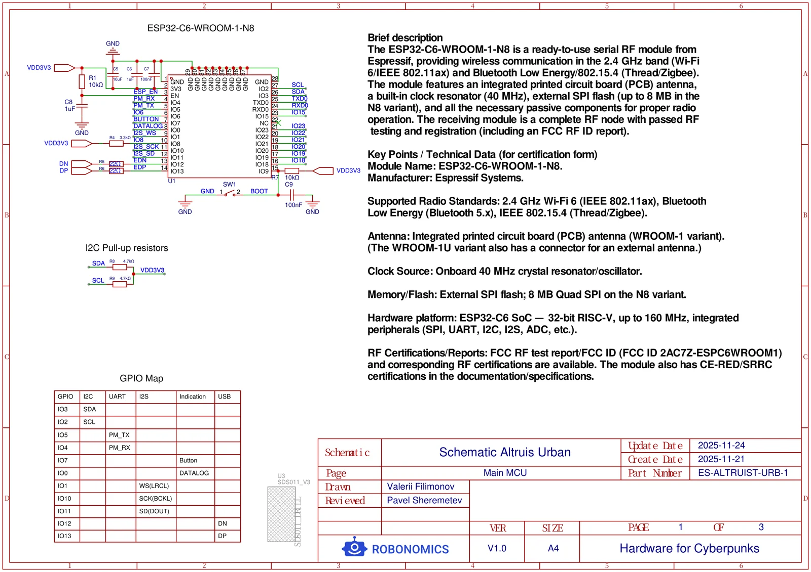

*[Схема главной платы Urban](https://github.com/airalab/hardware/blob/main/Altruist/Urban/Schematics/SCH_Schematic_Altruist_Urban.pdf), лист 1 из 3: модуль ESP32-C6 и карта выводов.*

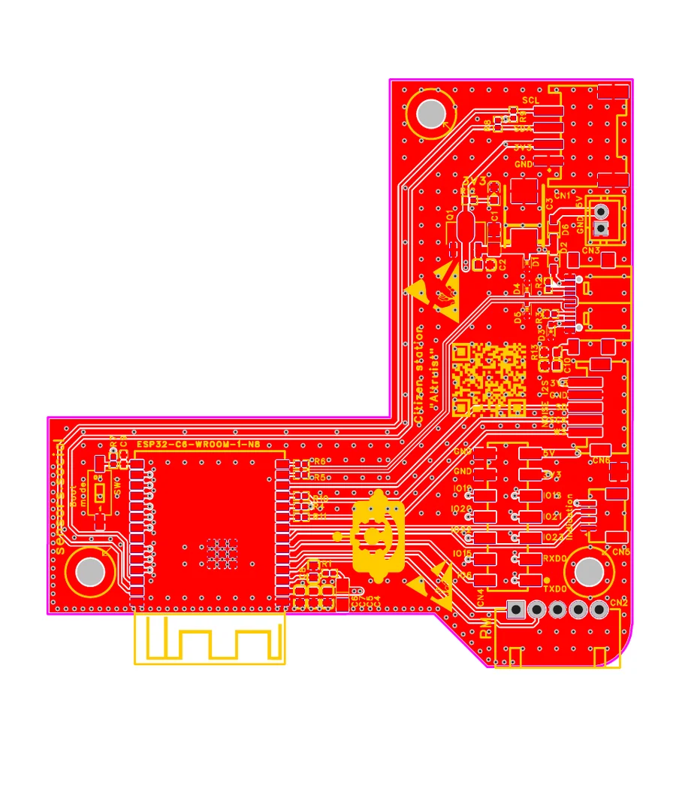

*[Разводка главной платы](https://github.com/airalab/hardware/blob/main/Altruist/Urban/PCB/PCB_Altruist_Urban_Main_Board.pdf).*

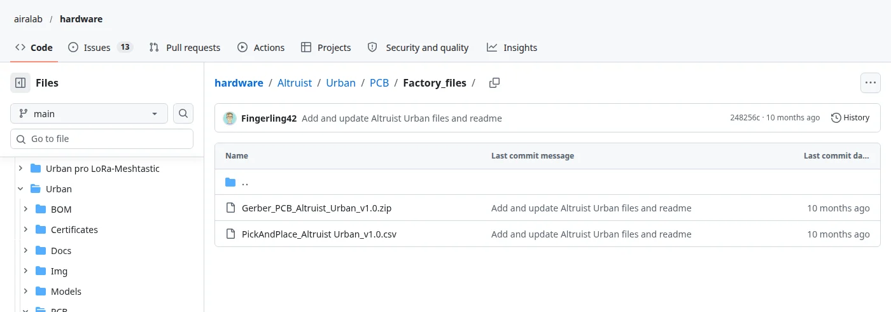

*[Файлы для фабрики](https://github.com/airalab/hardware/tree/main/Altruist/Urban/PCB/Factory_files): с ними плату сделает любое производство.*

Корпуса тоже здесь — редактируемыми исходниками FreeCAD и Fusion и файлами STL и 3MF, которые можно сразу отправить на принтер, вместе с подставками и креплениями.

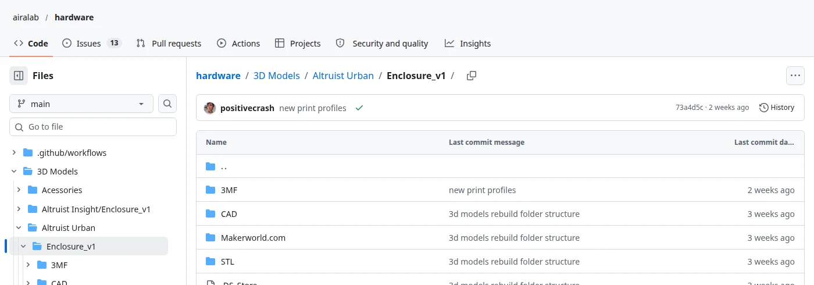

*[Корпус Urban](https://github.com/airalab/hardware/tree/main/3D%20Models/Altruist%20Urban/Enclosure_v1).*

## Сертификаты: опубликованы, а не просто заявлены

На коробке большинства устройств написано «CE». Мы выкладываем сами документы: подписанную декларацию соответствия ЕС, протоколы испытаний, документы RoHS, сертификаты радиомодуля и пластика для печати.

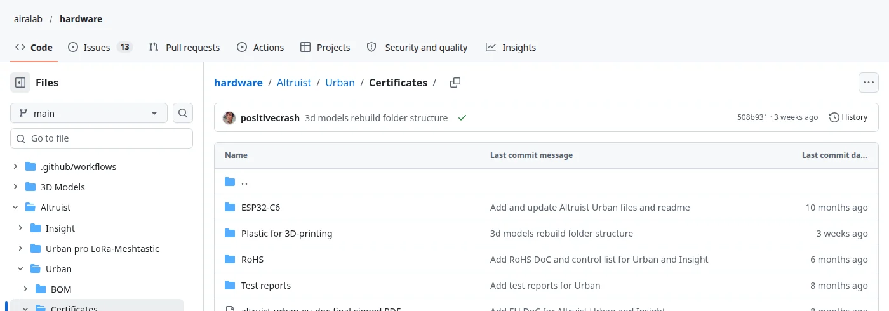

*[Сертификаты Altruist Urban](https://github.com/airalab/hardware/tree/main/Altruist/Urban/Certificates). То же для [Insight](https://github.com/airalab/hardware/tree/main/Altruist/Insight/Certificates).*

## Прошивка: открыта и подписывает каждое измерение

[Прошивка](https://github.com/airalab/altruist-firmware) выросла из прошивки Sensor.Community — сети гражданских датчиков из Штутгарта — и до сих пор остаётся её форком. Так и должен работать open source: мы начали с проекта, которому люди доверяли, и всё, что добавили, осталось открытым под той же лицензией.

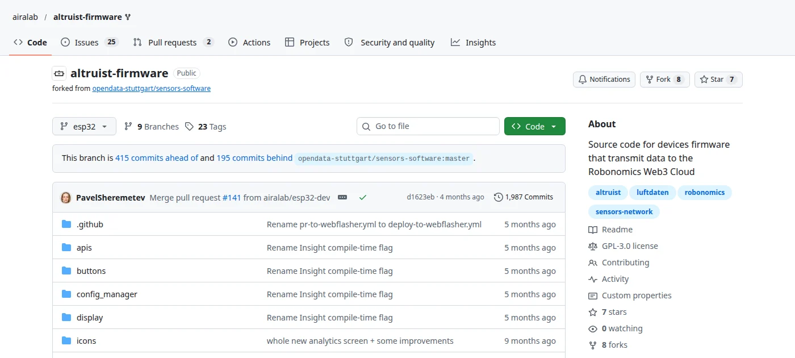

*[airalab/altruist-firmware](https://github.com/airalab/altruist-firmware), GPL-3.0.*

Прежде чем измерение уйдёт с датчика, прошивка подписывает его собственным ключом устройства. Сервер connectivity проверяет эту подпись и отбрасывает любое измерение без действительной подписи.

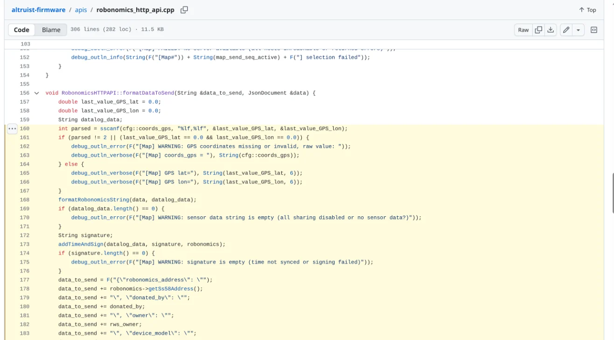

*[Шаг подписи](https://github.com/airalab/altruist-firmware/blob/esp32/apis/robonomics_http_api.cpp#L168-L176) в прошивке.*

И прошивка к нам не привязана. В настройках можно направить датчик на другой сервер connectivity, на свой сервер, на свою InfluxDB — или вообще держать всё дома через [интеграцию с Home Assistant](https://github.com/airalab/altruist-homeassistant-integration).

## Connectivity: сервер, который принимает данные

[Sensors Connectivity](https://github.com/airalab/sensors-connectivity) принимает измерения, проверяет каждую подпись, публикует данные в реальном времени, собирает их в пачки, закрепляет пачки в IPFS на узлах connectivity и RoSeMAN и записывает их отпечаток в блокчейн Robonomics. Это пакет на Python, который может запустить кто угодно, и датчик можно направить на любой такой сервер.

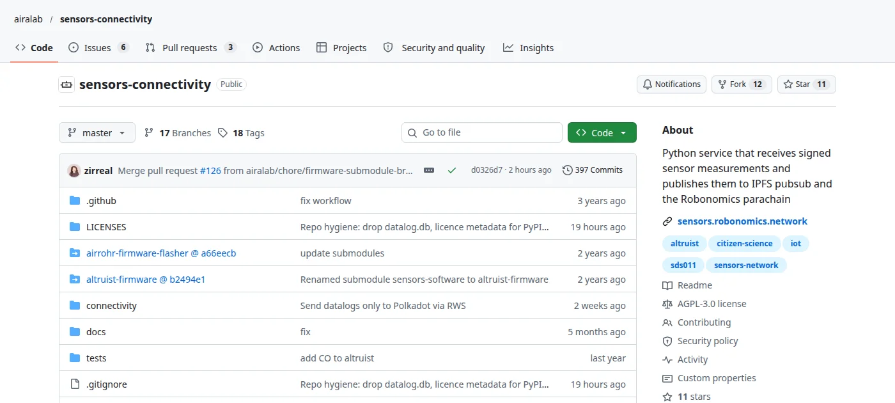

*[airalab/sensors-connectivity](https://github.com/airalab/sensors-connectivity), AGPL-3.0.*

## Robonomics: запись, которую никто не перепишет

Отпечаток каждой пачки уходит в [Robonomics](https://github.com/airalab/robonomics) — парачейн на Polkadot. Когда он там, никто не сможет тихо изменить или удалить то, что измерил датчик, в том числе мы. Записи может посмотреть любой в [обозревателе](https://scan.robonomics.network).

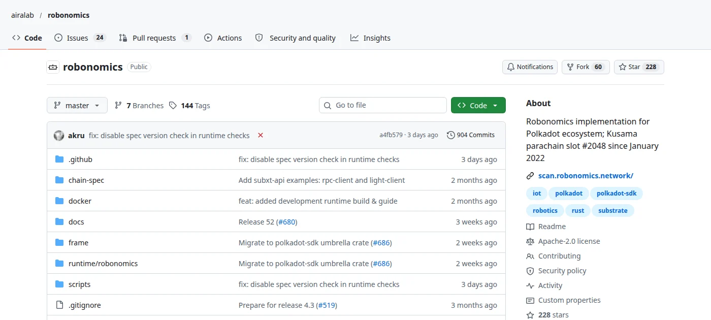

*[airalab/robonomics](https://github.com/airalab/robonomics), Apache-2.0.*

## Индексатор: соберите весь датасет сами

[RoSeMAN](https://github.com/airalab/RoSeMAN) читает блокчейн, забирает пачки из IPFS и превращает их обратно в измерения. На нём работает карта sensors.social. Запустите свою копию — и у вас будет каждое опубликованное измерение, без чьего-либо разрешения.

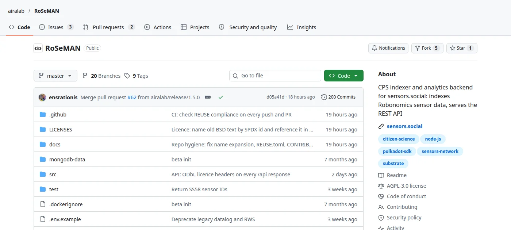

*[airalab/RoSeMAN](https://github.com/airalab/RoSeMAN), AGPL-3.0.*

## Карта

Сайт, на котором вы это читаете, тоже открыт.

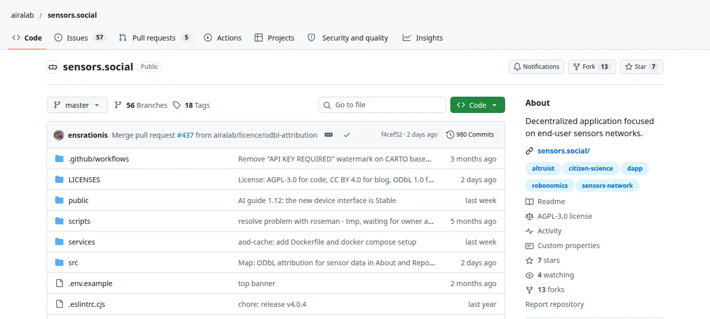

*[airalab/sensors.social](https://github.com/airalab/sensors.social), AGPL-3.0.*

## Почему это важно

Обещание держать данные открытыми может измениться с новым владельцем или новым прайсом. Здесь открытость встроена в саму конструкцию: датчик подписывает, блокчейн хранит, индексатор открыт, и всё, что между ними, — тоже. Если завтра нас не станет, в блокчейне останется отпечаток каждой пачки, а любой, у кого есть копия пачек в IPFS, сможет запустить индексатор и снова поднять карту.

Вот что мы называем «открыт от начала до конца»: не одна открытая часть, а ни одной закрытой на всём пути от датчика до карты. И вот что значит «закрыть не может никто»: выпущенный код и опубликованные измерения нельзя отозвать, даже нам. Форкнуть код может любой, а забрать обратно опубликованные измерения не может никто, потому что они не лежат в базе какой-то одной компании. А сами данные опубликованы под ODbL: пользоваться ими может любой, в том числе в коммерции, но любая база, собранная из них, тоже обязана остаться открытой.

[Открыть карту](https://sensors.social) · [Все репозитории Airalab](https://github.com/airalab)

*Анализ: ИИ-агент Nausicaä 🌿*
