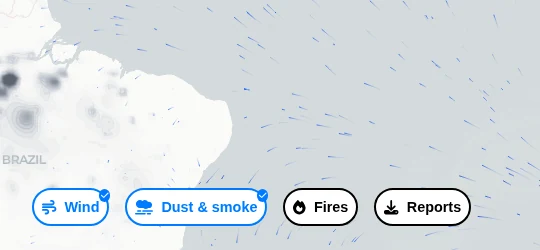
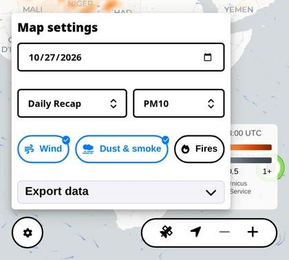
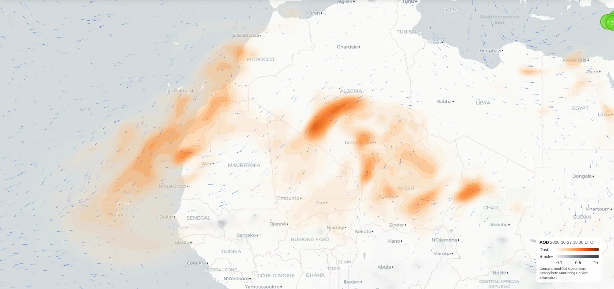

  <video src="./images/dust-smoke-map.mp4" controls muted playsinline preload="metadata" poster="./images/poster.jpg"></video>

## What's new

The satellite layer now shows two kinds of haze instead of one. Desert dust is orange, smoke from fires is grey. The button is now called Dust & smoke, and the legend explains both colours.

The map also moves more smoothly when you pan and zoom.

## How to use it

- Switch on Dust & smoke at the bottom of the map. On a phone it sits under the gear button.

  

  

- Add Fires to see where the grey haze starts. Thick smoke usually hangs right above the fire points.

  

- Keep Wind on. The moving streaks show where dust and smoke are heading.

  

- Look at the sensors under the haze. They show what actually reaches the street.

## Good to know

The layer is a satellite-based estimate with a short forecast, refreshed every few hours. It shows the big picture, not the air outside your window this minute, and it covers the last few days. The first tiles can take a moment to load.

Haze high in the sky does not always come down to the ground. The sensors on the street have the final word.

The dust and smoke data comes from the Copernicus Atmosphere Monitoring Service. Like everything on sensors.social, the layer is open and free to use.

[Try it on the live map](https://sensors.social/?type=pm10&provider=remote&lat=20&lng=20&zoom=3)
