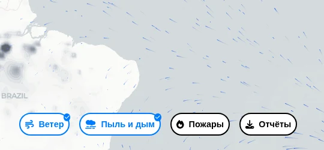
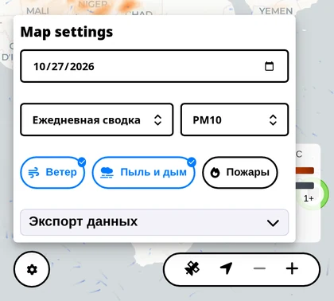
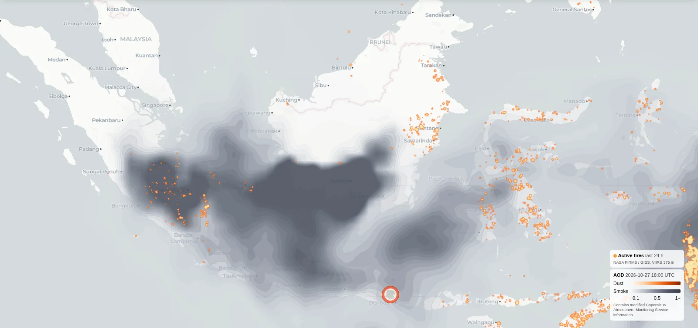
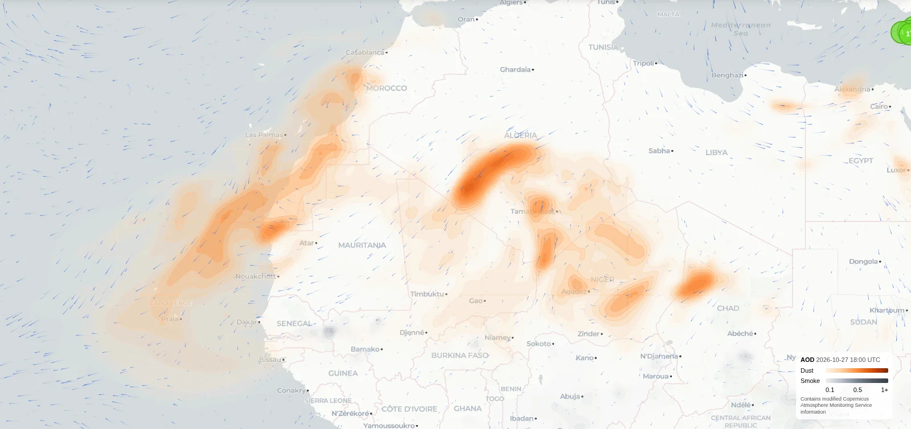

  <video src="./images/dust-smoke-map.mp4" controls muted playsinline preload="metadata" poster="./images/poster.jpg"></video>

## Что нового

Спутниковый слой показывает теперь два вида дымки. Пыль из пустынь — оранжевая, дым от пожаров — серый. Кнопка называется «Пыль и дым», легенда поясняет оба цвета.

Заодно карта стала плавнее двигаться и масштабироваться.

## Как пользоваться

- Включите «Пыль и дым» внизу карты. На телефоне — под кнопкой-шестерёнкой.

  

  

- Добавьте «Пожары», чтобы увидеть, откуда начинается серая дымка. Плотный дым обычно висит прямо над очагами.

  

- Оставьте включённым ветер: бегущие штрихи показывают, куда несёт пыль и дым.

  

- Посмотрите на датчики под дымкой. Они покажут, что на самом деле доходит до улицы.

## Полезно знать

Слой — оценка по спутниковым данным с коротким прогнозом, обновляется раз в несколько часов. Он показывает общую картину, а не воздух за окном в эту минуту, и охватывает последние несколько дней. Первые тайлы иногда грузятся не сразу.

Дымка высоко в небе не всегда опускается к земле. Последнее слово — за датчиками на улице.

Данные о пыли и дыме — от Copernicus Atmosphere Monitoring Service. Как и всё на sensors.social, слой открыт и бесплатен.

[Открыть живую карту](https://sensors.social/?type=pm10&provider=remote&lat=20&lng=20&zoom=3)
