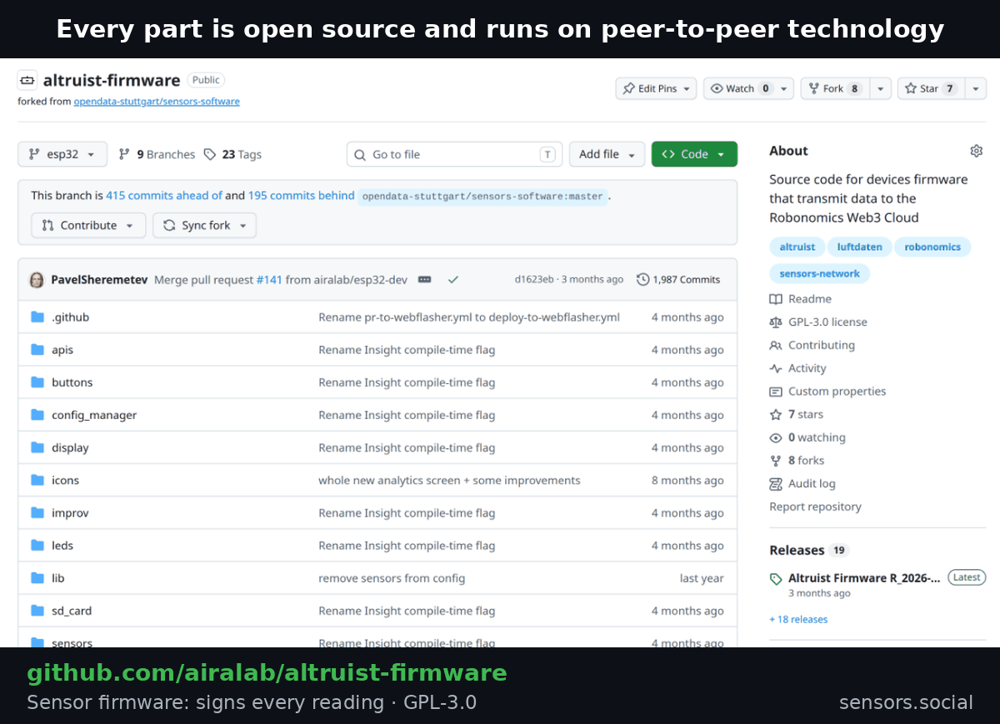
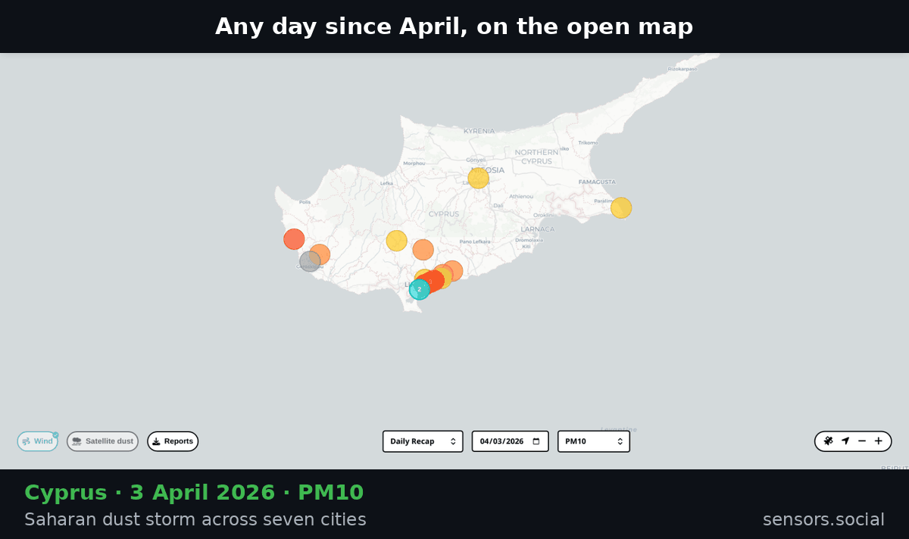

Cities, researchers and climate models all want the same thing: air measured where people live, street by street, hour by hour. That data is becoming valuable. The familiar way to build it is to make it an asset — sell the device, send the readings to the maker's cloud, and charge for access.

We chose the other way. sensors.social is building an open air dataset of the planet: a public good, like a library or a park, that grows with every sensor someone hangs on a balcony.

## Open by architecture, not by promise



A promise to keep data open can change with a new owner or a new pricing page. So we made openness part of the structure:

- **The device signs every reading.** Altruist firmware and hardware are open source.
- **The Robonomics open-source cloud seals each record** in a public ledger, exactly as it was measured.
- **Anyone can rebuild the whole dataset.** The indexer that turns the ledger into readings is open source too. Run your own copy and you hold every published record, with no permission from us.

Even we cannot close it. That is the point. Each owner decides whether their sensor publishes; what is published becomes common ground.

## Already in the dataset



Since April: about 18 million records from more than 200 home sensors in 22 countries. A few places worth opening:

**Cyprus — a densely measured Mediterranean island.** More than 60 sensors and 5 million records. The network followed Saharan dust across seven cities in early April, and on the morning of 18 April watched it come down to balcony level across the island. [Case study](/blog/cyprus-saharan-dust-storm)

**Koh Phangan, Thailand.** Background air among the cleanest we measure, with 1,199 short, intense burning episodes hidden inside it that no daily average would show. In April fine dust ran two to three times higher than in midsummer. [One year on](/blog/koh-phangan-one-year-later)

**Togliatti — an industrial post-Soviet city.** 30 sensors and 2.3 million records, from 37 °C in July to 2.7 °C on 3 October. In the cool months of April, May and September, indoor CO2 passed 1,000 ppm in about one hour in six; in summer, almost never.

**Réunion and Bali.** Two homes on two volcanic islands, recording around the clock since April — the network's points in the Indian Ocean and in Indonesia.

**Europe.** Austria, Germany, Spain, France, Croatia, Poland, the UK and more — 31 sensors so far, with new ones joining this autumn.

## Take it

```
GET https://roseman.robonomics.network/api/v2/sensor/markers/{from}/{to}
GET https://roseman.robonomics.network/api/v2/sensor/{sensor_id}/{from}/{to}
```

Times are Unix seconds: the first call lists every sensor active in the window, the second returns its readings. Built something with it? Show us.

Every new sensor adds one more point to a map of the planet's air that belongs to all of us.
