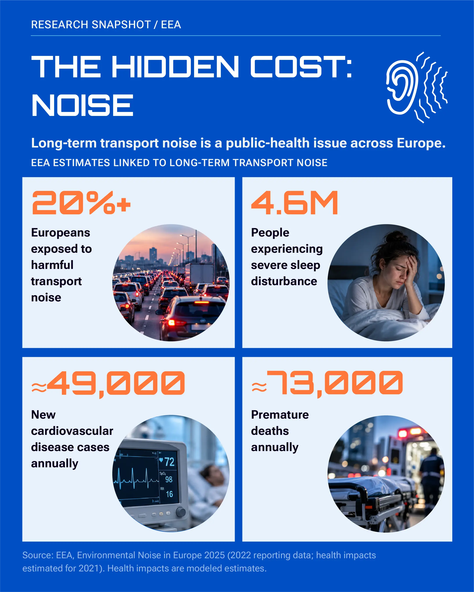
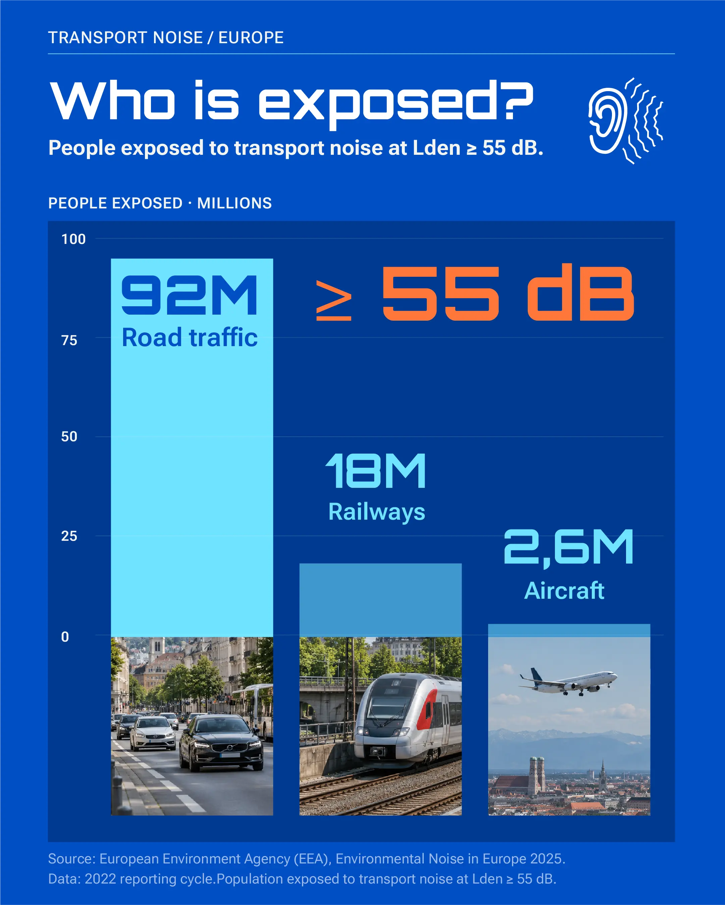
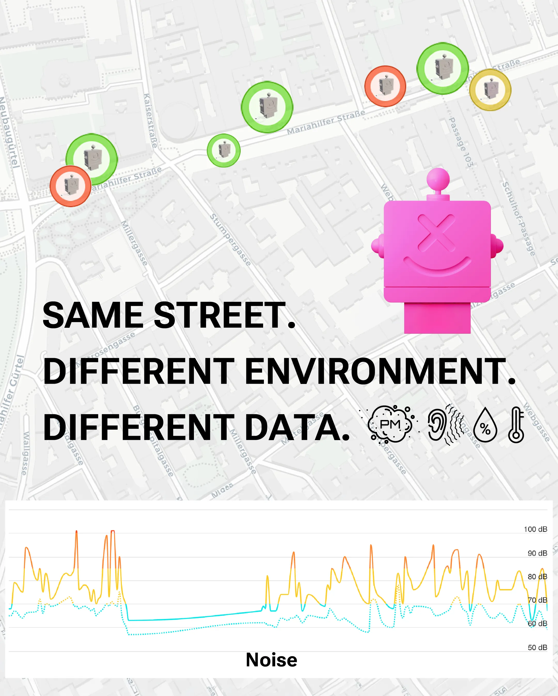
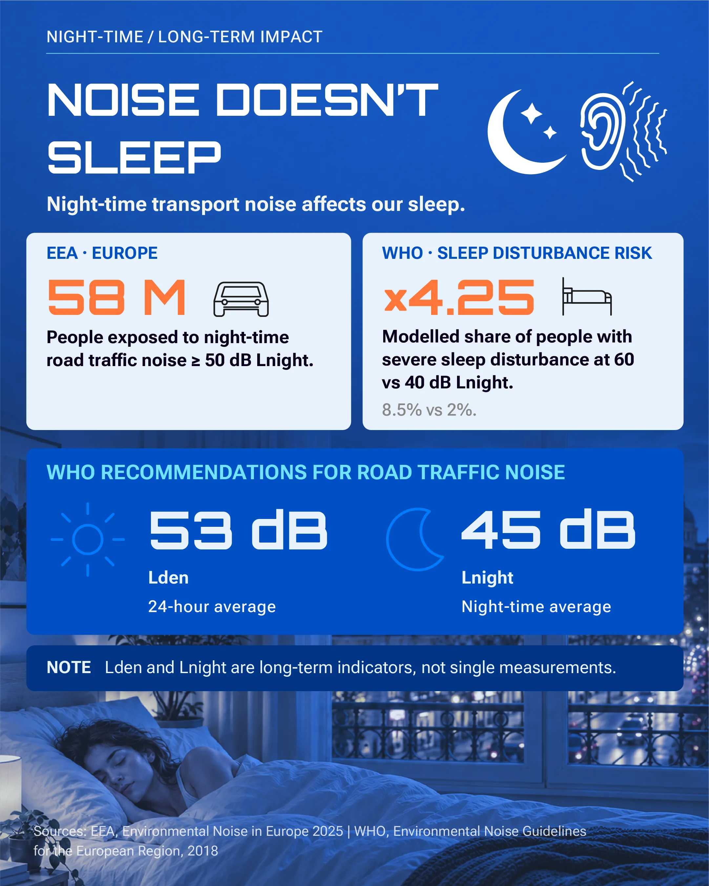
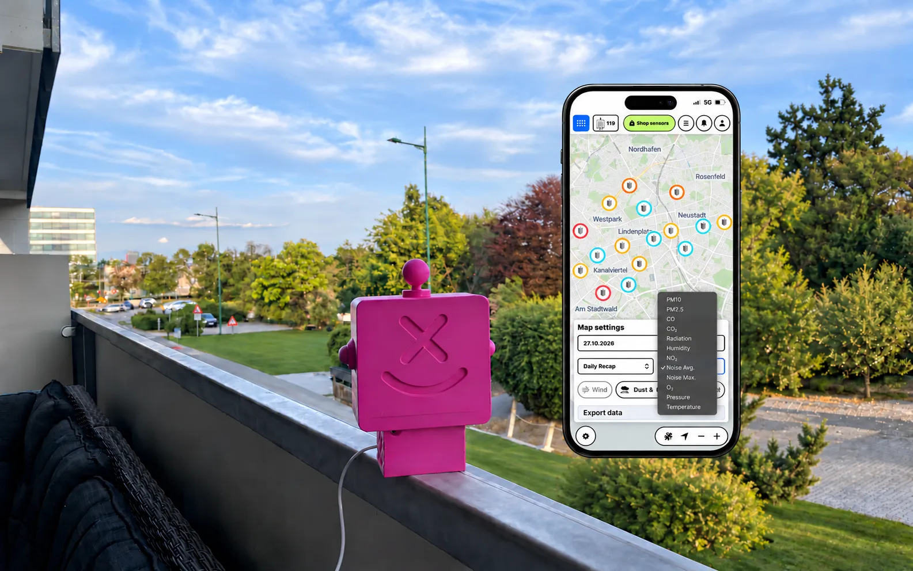
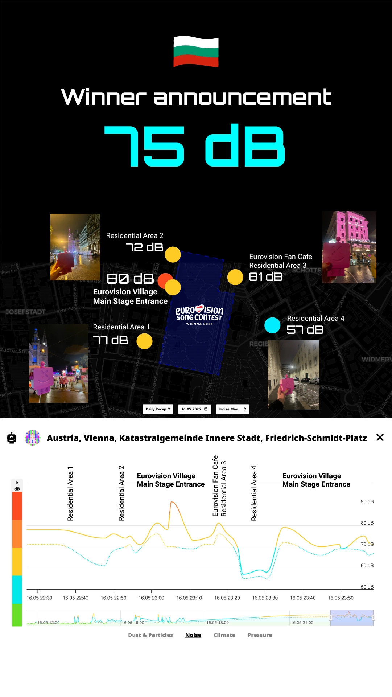

Cars, motorcycles, construction sites, public transport, music from bars and restaurants, and nighttime events all shape the soundscape in which we live, work, and relax. Over time, we become so accustomed to constant urban noise that we barely notice it. But getting used to a sound does not mean it stops affecting us.

**Noise pollution is more than a matter of comfort. Long-term exposure to unwanted noise is linked to sleep disturbances, stress, cardiovascular disease, and a reduced quality of life. That is why noise deserves the same attention as air quality: we should not only notice it, but measure it.**

## 1. How Serious Is Urban Noise Pollution?

We tend to accept urban noise as an unavoidable part of city life. But how much does it affect our health? The scale of the problem is greater than many people realize.

According to the **European Environment Agency (EEA)**, more than **20% of Europeans** are exposed to harmful levels of transport noise. Under the stricter recommendations of the World Health Organization (WHO), that figure rises to **over 30%**. These findings come from the _Environmental Noise in Europe 2025_ report.

Even more concerning are the health consequences that are not always immediately apparent. The EEA estimates that long-term exposure to transport noise in Europe contributes to approximately **4.6 million cases of severe sleep disturbance, 49,000 new cases of cardiovascular disease, and 73,000 premature deaths each year**. These are population-level estimates of the health burden associated with noise exposure, not individual medical diagnoses directly attributed to noise.

**Urban noise is more than an annoyance outside our windows. It is a major public health issue affecting millions of people, even those who have long grown accustomed to the sounds of their city.**

## 2. What Are the Biggest Sources of Noise in Europe?

When we think about urban noise, construction sites, nightclubs, and large events often come to mind. But **road traffic is the largest source of transport noise exposure in Europe**.

According to the EEA, approximately **92 million people** are exposed to road traffic noise at or above 55 dB Lden, compared with **18 million** exposed to railway noise and **2.6 million** to aircraft noise.

Construction, concerts, and nighttime events generally create temporary noise, while **roads, railway lines, and airports generate a recurring background of noise**. And its intensity can vary significantly even between neighboring streets and city blocks.

<InstagramEmbed url="https://www.instagram.com/reel/DakvTk2AF09/?utm_source=ig_web_copy_link&xtok=MWQ1ZGUxMzBkMA==&srtk=MWQ1ZGUxMzBkMA=" />

## 3. How Does Urban Noise Affect Sleep, Health, and Learning?

We become so accustomed to urban noise that we often stop noticing it. Yet constant traffic, motorcycles, and other sounds can still affect our well-being, contribute to stress, make it harder to concentrate, and reduce the quality of our rest.

**Children are particularly vulnerable to noise.** According to EEA estimates, more than **500,000 children in Europe experience reading difficulties associated with transport noise exposure**. This is especially relevant for schools and kindergartens near busy roads.

**At night, noise can be even more disruptive.** Passing cars, motorcycles, and other sounds may disturb our sleep even when they do not wake us completely. In the morning, we may feel tired without understanding why, despite having spent the whole night in bed.

According to the EEA, approximately **58 million Europeans** are exposed to nighttime road traffic noise at or above 50 dB Lnight. The World Health Organization (WHO) recommends reducing long-term road traffic noise exposure to below **53 dB Lden** and **45 dB Lnight**. These are long-term noise exposure indicators, not individual readings from a standard sound meter.

**Urban noise can make it harder for children to learn, adults to concentrate, and everyone to get a good night's sleep. And just because we have grown used to it does not mean it has stopped affecting us.**

## 4. Why Measure Noise Where We Actually Live?

City noise maps provide a general overview, but **noise levels can vary significantly even between neighboring streets and throughout the day** due to traffic, construction, and other sources.

**A city map shows the bigger picture, while a local sensor reveals what is happening right outside your window.** Regular measurements help track changes in noise levels, compare daytime and nighttime conditions, and identify quieter times to open your windows.

## 5. City Events: How Can We Balance Celebrations and Residents' Comfort?

Concerts and festivals bring cities to life, but they can also create additional noise for people living nearby.

**On May 16, 2026, during the Eurovision Grand Final in Vienna, Altruist Urban was used to monitor noise** around Rathausplatz and nearby residential streets. Despite the scale of the celebrations, the residential area observed during the monitoring remained remarkably quiet — a positive example of how Vienna managed the event.

**Local noise monitoring can benefit both residents and city authorities:** actual measurements provide a factual basis for discussing the impact of public events, rather than relying solely on subjective impressions.

<InstagramEmbed url="https://www.instagram.com/p/Dacic9EDpEy/" />

## 6. Why Is Noise Monitoring Becoming Part of the Smart City?

**A smart city is a city that makes decisions based on data.** Alongside air quality and traffic, noise is another important environmental factor worth monitoring.

Regular measurements help track changes in the urban soundscape and support practical decisions: **choosing quieter walking routes, finding better times to open windows, assessing the comfort of residential neighborhoods, and planning public events**.

However, a sensor cannot automatically identify the source of noise or replace a professional acoustic assessment. It provides objective measurements that can support analysis and informed discussion.

**The [sensors.social](https://sensors.social/) platform brings environmental measurements together on an interactive map, while Altruist Urban adds local noise monitoring to air quality data.**

## Sources

1. [European Environment Agency — Environmental Noise in Europe 2025](https://www.eea.europa.eu/en/analysis/publications/environmental-noise-in-europe-2025)
2. [WHO — Environmental Noise Guidelines for the European Region](https://www.who.int/europe/publications/i/item/9789289053563)
3. [WHO — Night Noise Guidelines for Europe](https://www.who.int/europe/publications/i/item/9789289041737)
4. [American Academy of Audiology — Levels of Noise in Decibels](https://www.audiology.org/wp-content/uploads/2023/09/PR23-Poster-NoiseChart-24x36-1.pdf)
5. [NIH — Information about Hearing, Communication, and Understanding](https://www.ncbi.nlm.nih.gov/books/NBK20366/)
6. [CDC — About Noise-Induced Hearing Loss](https://www.cdc.gov/hearing-loss/about/)
7. [Altruist Firmware — Open Source Code](https://github.com/airalab/altruist-firmware)
8. [sensors.social — Eurovision 2026 Noise Monitoring](https://www.instagram.com/p/Dacic9EDpEy/)
9. [sensors.social — Environmental Monitoring Map](https://sensors.social/)
10. [Eurovision Song Contest — Vienna 2026 Host City Guide](https://www.eurovision.com/eurovision-song-contest/vienna-2026/host-city-guide/)
